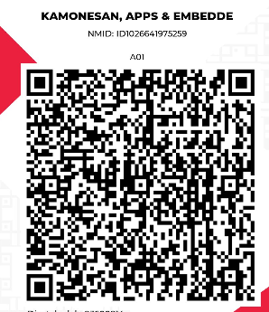

# PILAR Hub

PILAR adalah kumpulan simulasi, lab maya, dan game belajar yang dibuat guru untuk dipakai di kelas. Semuanya dibuka dari satu halaman, yaitu Hub, dan paling enak dimainkan di layar sentuh besar (IFP) supaya beberapa siswa bisa maju bersama. Laptop dan HP juga bisa.

Coba langsung di browser: **https://tomrzetd.github.io/berangkatin-pilar/**

Tidak perlu daftar atau masuk akun. Setelah dibuka sekali, sebagian besar aplikasi tetap jalan walaupun internet putus.

## Kenapa dibuat

Banyak konsep sulit dipahami siswa karena hanya dibaca. Siswa membaca bahwa cahaya membelok di kaca, bahwa tekanan bergantung pada luas, atau bahwa gelas berisi air bisa ditemukan lewat irisan himpunan. Padahal konsep seperti itu paling cepat dipahami kalau siswa bisa mencoba sendiri, salah, lalu melihat kenapa salah.

Karena itu setiap aplikasi di PILAR disusun dengan pola yang sama:

1. **Mulai dari kejadian nyata.** Misalnya video kotak laser, petani yang lupa mencatat pupuknya, atau kabel internet di dasar laut.
2. **Siswa mencoba dulu, baru diberi nama konsepnya.** Siswa menggeser lensa sampai titik cahayanya mengecil. Setelah itu baru muncul istilah "titik fokus".
3. **Ada misi kecil yang berjenjang.** Setiap misi hanya bisa selesai kalau konsepnya benar-benar dipakai, jadi tidak bisa ditebak asal.
4. **Ditutup dengan kisah nyata dan tantangan rekayasa.** Contohnya Observatorium Bosscha, Palapa Ring, atau teropong dari pipa paralon. Siswa melihat bahwa yang barusan mereka coba dipakai orang sungguhan, dan mereka pun bisa membuatnya.

Hitungannya juga sungguhan. Pembiasan cahaya memakai hukum Snell, gerak bola memakai rumus parabola, dan alih aksara Sunda mengikuti kaidah Aksara Sunda Baku. Bagian-bagian ini diperiksa dengan uji otomatis yang dicocokkan ke rumus di buku pelajaran.

## Isi PILAR

Daftar lengkapnya ada di `apps/registry.js`. Berikut garis besarnya per mata pelajaran.

### IPA dan Fisika

| Aplikasi | Yang dilakukan siswa |
|---|---|
| 🔭 **Jalan Cahaya** | Menembakkan laser ke lensa, prisma, dan cermin. Kemudian mengirim pesan lewat serat optik, mengatur fokus kamera HP, dan merakit teropong. Ditutup dengan tiga proyek nyata yang bisa dibangun di sekolah. |
| 🫧 **Lab Maya Tekanan** | Membandingkan sepatu salju dengan ujung paku, menyelam di kolam, merancang lift hidrolik, dan menerbangkan drone dengan prinsip Bernoulli. |
| 🧲 **Gaya Lorentz** | Menebak arah gaya pada kawat berarus di dalam medan magnet, lalu membuktikannya. |
| 🔋 **Lab Baterai** | Mengecas baterai lithium-ion pelan dan cepat, melihat panas dan umur baterai, lalu merancang baterai HP dan mobil listrik. |
| 🎯 **Bola Sang Pemburu** | Duel dua tim mengatur sudut dan kecepatan awal. Siswa belajar gerak parabola dan jatuh bebas. |
| 〰 **SoundScope** | Melihat bunyi sebagai gelombang lewat mikrofon, membuat nada, mengirim pesan dengan bunyi, mengukur jarak seperti sonar, dan mengamati efek Doppler. |
| 🔬 **Microscope Lab** | Memakai mikroskop USB, melacak gerak mikroorganisme, dan menumpuk fokus. Bisa juga mengendalikan motor fokus dengan ESP32. |
| 🌋 **BioWeb Ciremai** | Menjelajahi jaring-jaring kehidupan Gunung Ciremai dalam 3D, dari puncak sampai sawah. |
| 🌍 **Atlas Bumi 3D** | Terbang ke kota atau koordinat mana pun, melihat siang dan malam yang sebenarnya, zona waktu, arah kiblat, dan memahami kenapa peta datar membesarkan Greenland. |

### Informatika

| Aplikasi | Yang dilakukan siswa |
|---|---|
| 🧪 **Lab Misteri Pak Taro** | Soal "Pupuk Ajaib" dari buku Informatika kelas VIII. Siswa menyiram, mencatat perubahan bunga sebagai simbol, mencari irisan, membaca kode biner tiap gelas, lalu merancang percobaannya sendiri. |
| 🤖 **Misi Gerbang Logika** | Komik interaktif kelas IX tentang operand, operator, biner, heksadesimal, dan gerbang NOT/AND/OR/NAND/NOR. |
| 🔌 **Papan Rangkai** | Merangkai gerbang logika dan IC 74HC di breadboard maya, lengkap dengan tabel kebenaran otomatis. |
| 🚚 **MBG Delivery Duel** | Dua tim berlomba mencari rute terpendek dari dapur ke sekolah. Siswa belajar algoritma rute. |
| ❄️ **Frost Breakout** | Game pemecah es dengan Mode Debug. Siswa bisa menghentikan game, menjalankannya baris demi baris, dan melihat isi "otak" game. |
| ◈ **Rubik Orbit** | Memindai kubus Rubik asli dengan kamera, melihatnya dalam 3D, dan mencari langkah penyelesaiannya. |

### Matematika

| Aplikasi | Yang dilakukan siswa |
|---|---|
| 🌀 **Lingkaran Ajaib** | Melihat sinus dan kosinus lahir dari lingkaran satuan, membuat kurva Lissajous, dan menggambar hati dengan lingkaran berputar (deret Fourier). |
| 🐍 **Frost Snake** | Duel ular dua tim yang memakan jawaban hitungan yang benar. |

### Bahasa dan Literasi

| Aplikasi | Yang dilakukan siswa |
|---|---|
| 🔖 **Jejak Kata** | Membaca buku cerita, menandai kata kunci, lalu menyambungkannya ke topik besar dengan kabel. Hati-hati, ada topik jebakan. |
| 📜 **na Daluang** | Merakit aksara Sunda dari ngalagena dan rarangkén, menulis aksara di layar, mengubah nama menjadi aksara Sunda, dan kuis membaca. |

### Gerak dan Kreasi

| Aplikasi | Yang dilakukan siswa |
|---|---|
| ✍️ **Air Writing** | Menulis di udara dengan jari di depan kamera, termasuk latihan menebalkan huruf. |
| 🧩 **PuzzleSnap** | Mengubah foto menjadi puzzle yang bisa disusun ramai-ramai di layar sentuh. |

## Fitur Hub

- **Tiga tampilan.** Kalem (terang, bawaan), Gelap, dan Pink. Pilihan di Hub ikut terbawa ke aplikasi. Bagian panggung simulasi tetap dijaga agar mudah dilihat dari belakang kelas.
- **Ramah IFP.** Banyak siswa bisa menyentuh layar bersamaan tanpa memunculkan menu klik kanan. Tombolnya besar, dan semua bab di aplikasi baru dibuat muat satu layar tanpa perlu digulir.
- **Menyesuaikan perangkat.** Di IFP dengan GPU sederhana (misalnya Hisense dengan Mali-G52), efek berat otomatis dikurangi supaya tetap lancar.
- **Tanpa akun.** Kemajuan siswa disimpan di perangkat itu saja.
- **Pulse (opsional).** Guru bisa mengaktifkan hitungan pengunjung anonim dan "Chat dengan Developer" untuk mengirim saran atau laporan masalah. Fitur ini mati sampai pengguna sendiri menyalakannya.

## Jalan di mana saja

| Perangkat | Cara pakai |
|---|---|
| Browser (laptop, Chromebook, HP) | Buka alamat di atas. Bisa dipasang sebagai aplikasi (PWA) lewat menu browser. |
| Windows 64-bit | Installer `.exe` atau versi portable yang langsung jalan tanpa dipasang. |
| Linux 64-bit | `.AppImage` atau `.deb`. |
| Android: HP, tablet, dan IFP | Satu berkas `.apk`. Di IFP dan tablet, tampilan otomatis mendatar dan layar tidak mati sendiri. |

Versi Windows, Linux, dan Android membawa semua pustaka dan model AI di dalamnya, jadi tetap jalan tanpa internet. Unduh dari halaman **Releases → `native-latest`**. Berkas di sana dibuat ulang otomatis setiap ada perubahan di `main`. Panduan memasang di IFP ada di [`native/README.md`](native/README.md).

Fitur yang tetap butuh internet hanya Pulse dan model klasifikasi Teachable di Microscope Lab.

## Privasi dan keamanan

- PILAR tidak meminta nama, email, atau data siswa.
- Kamera dan mikrofon hanya dipakai di aplikasi yang membutuhkannya, setelah diizinkan. Gambarnya diolah di perangkat dan tidak dikirim ke mana pun.
- Basis data Pulse dilindungi aturan akses (Row Level Security). Kunci yang ada di repo hanya kunci publik.

Penjelasan lengkap dan cara melaporkan celah keamanan ada di [`SECURITY.md`](SECURITY.md).

## Untuk pengembang

```
index.html, app.js      Hub
apps/<nama>/            satu folder per aplikasi, berdiri sendiri
apps/registry.js        daftar aplikasi yang tampil di Hub
apps/_starter/          kerangka untuk aplikasi baru
core/                   bagian bersama: profil perangkat, penjaga sentuhan, Pulse
css/                    tema Hub, tema Kertas & Ceria, skin terang per aplikasi
labs/                   mesin fisika yang dipakai bersama
native/                 pembungkus Electron dan Android
pulse/                  skema basis data Pulse
tests/                  uji otomatis
tools/                  pembuat skin terang
docs/                   catatan dan gambar
```

Menjalankan di komputer sendiri cukup dengan server statis apa saja:

```bash
python3 -m http.server 8080
# buka http://localhost:8080
```

Menjalankan semua uji (tanpa `npm install`):

```bash
node tests/jalankan-semua.mjs
```

Menambah aplikasi baru:

1. Salin `apps/_starter/` menjadi `apps/nama-aplikasi/`.
2. Daftarkan di `apps/registry.js`.
3. Pasang `core/device-profile.js` supaya dapat skin, mode ringan, dan penjaga sentuhan.
4. Pastikan ada tombol kembali ke Hub dan kredit pembuat di bagian atas.
5. Minta izin kamera atau mikrofon hanya saat benar-benar dipakai.
6. Jalankan semua uji sebelum mengirim perubahan.

## Dukung pengembang

PILAR gratis untuk sekolah mana pun. Kalau aplikasi ini bermanfaat dan Bapak/Ibu ingin membantu biaya perangkat uji, IFP, komponen elektronik, dan hosting, dukungan bisa dikirim lewat QRIS berikut. Berapa pun jumlahnya, terima kasih banyak.

<p align="center"></p>

Nama penerima di aplikasi pembayaran harus **Kamonesan, Apps & Embedde** (Kuningan), NMID **ID1026641975259**. Kalau yang muncul berbeda, jangan lanjutkan pembayaran dan kabari kami lewat Issue.

## Pembuat

Dibuat dan dirawat oleh guru di Kuningan, Jawa Barat.

`by : rizalabdurrahman05@guru.smp.belajar.id`

Saran, laporan masalah, dan ide aplikasi baru bisa dikirim lewat GitHub Issues atau tombol Chat di Hub.

## Lisensi

Repo ini belum memakai lisensi terbuka. Bila ingin memakai ulang atau mengembangkan kodenya di luar pemakaian kelas, silakan hubungi pembuat terlebih dahulu. Font di `vendor/fonts` memakai lisensi SIL Open Font License, dan berkas lisensinya ada di folder yang sama.
